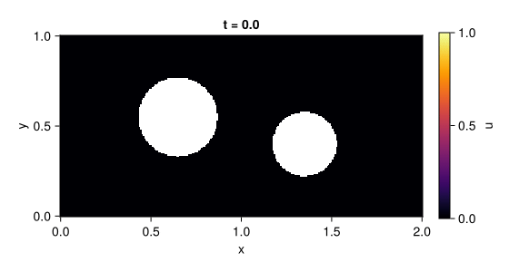
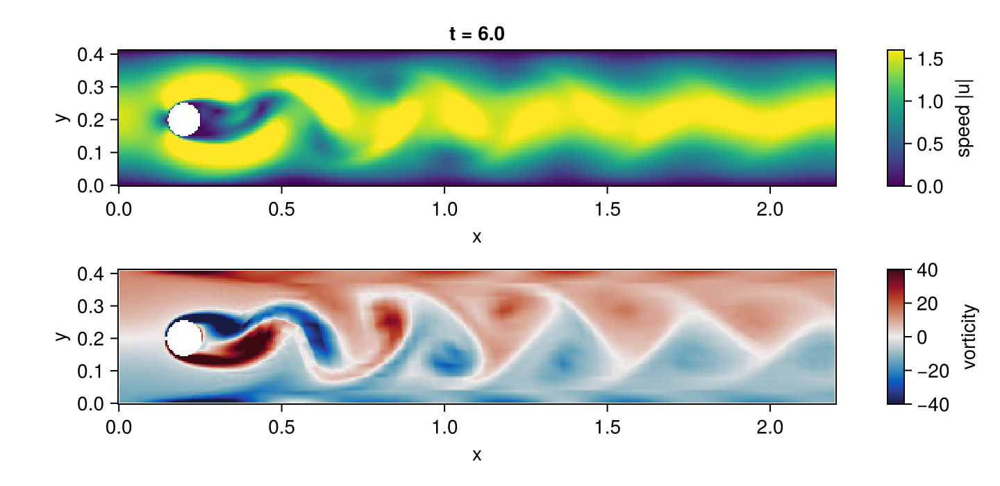
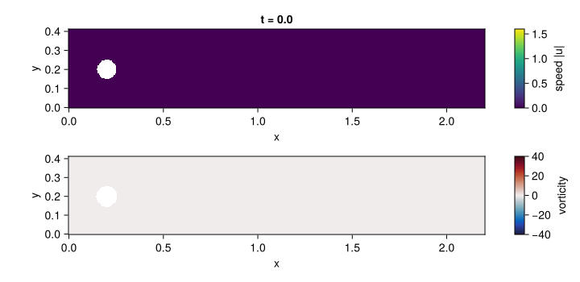

# FiniteElementMethod.jl



FiniteElementMethod.jl solves PDEs written in strong form with
[ModelingToolkit.jl](https://docs.sciml.ai/ModelingToolkit/stable/) on unstructured meshes. Write
the equation and its boundary conditions as you would on paper, put them on a
[Gmsh](https://gmsh.info) geometry, and the package derives the Galerkin weak form, assembles it
with [Ferrite.jl](https://github.com/Ferrite-FEM/Ferrite.jl) and hands you a `DAEProblem` for the
[DifferentialEquations.jl](https://docs.sciml.ai/DiffEqDocs/stable/) solvers. No mesh loops, no
weak forms by hand, and no scalarisation: each field is one array unknown.

The animation above is this code, run by the documentation build:

```julia
using FiniteElementMethod, ModelingToolkit, DomainSets, FerriteGmsh, OrdinaryDiffEqBDF
using ModelingToolkit: t_nounits as t

@parameters k α
@variables x y u(..)
Dt, Dx, Dy = Differential(t), Differential(x), Differential(y)

grid = togrid(pkgdir(FiniteElementMethod, "examples", "plate.geo"))   # Gmsh physical groups become pieces
Ω = MeshDomain(grid)
Γ_in, Γ_wall, Γ_out = boundarypiece.(Ω, (:inlet, :wall, :outlet))
Dn_wall, Dn_out = NormalDerivative(Γ_wall), NormalDerivative(Γ_out)

eqs = [Dt(u(t, x, y)) ~ Dx(k * Dx(u(t, x, y))) + Dy(k * Dy(u(t, x, y)))]
bcs = [
    u(t, Γ_in) ~ sin(t)^2,                          # Dirichlet: a pulsing heated pipe
    Dn_wall(u(t, Γ_wall)) ~ 0,                      # Neumann: insulated edges and second hole
    k * Dn_out(u(t, Γ_out)) + α * u(t, Γ_out) ~ 0,  # Robin: convective cooling
    u(0, x, y) ~ 0,
]
domains = [(x, y) ∈ Ω, t ∈ Interval(0.0, 6.0)]
@named pdesys = PDESystem(eqs, bcs, domains, [t, x, y], [u(t, x, y)], [k => 0.2, α => 2.0])

sol = solve(discretize(pdesys, FEMDiscretization(Ω, t)), DFBDF())
sol(6.0, 1.0, 0.9; dv = u(t, x, y))                 # the temperature at any point, at any time
```

`x` and `y` are bound to the mesh by `(x, y) ∈ Ω`, conditions live on named boundary pieces as
traces `u(t, Γ)` and normal derivatives `NormalDerivative(Γ)`, and the solution is indexed and
called in the same symbols. The [documentation](https://docs.sciml.ai/FiniteElementMethod/stable/)
covers how this differs from [MethodOfLines.jl](https://docs.sciml.ai/MethodOfLines/stable/).

A boundary with no condition gets the natural zero-flux condition, with a warning that lists it;
declare it with `FEMDiscretization(Ω, t; natural = [Γ_out])`, or make the warning an error with
`boundary_check = :error`. A boundary given as a lower-dimensional mesh becomes a piece with
`add_boundary_pieces!(grid, :inlet => inlet_mesh)`. See
[boundary conditions](https://docs.sciml.ai/FiniteElementMethod/stable/boundary_conditions/).

## Navier–Stokes





The incompressible Navier–Stokes equations are one more strong-form `PDESystem`: three equations
for the velocity components `u`, `v` and the pressure `p`, discretized with Q2/Q1 Taylor–Hood
elements and integrated as an index-2 DAE. The flow starts at rest in the
[DFG benchmark](https://docs.sciml.ai/FiniteElementMethod/stable/navier_stokes/) channel with a
cylinder, at Reynolds number 100 (the inflow of case 2D-2), and sheds a vortex street. The
images above are rendered by the two code blocks below, which `examples/ns_showcase.jl` runs
as written (a test fails when they change without the images being regenerated).
It is a showcase on a coarse mesh: the measured Strouhal number is about 0.3, the benchmark's
value, but the run is not validated against the benchmark's shedding data. The steady Reynolds
number 20 case (2D-1) is the one checked against its drag, lift and pressure difference.

```julia
using FiniteElementMethod, ModelingToolkit, DomainSets, OrdinaryDiffEqBDF
using OrdinaryDiffEqBDF: NLNewton
using LinearSolve: UMFPACKFactorization
using SciMLBase: CheckInit
using ModelingToolkit: t_nounits as t

include(pkgdir(FiniteElementMethod, "examples", "dfg_cylinder", "mesh.jl"))   # dfg_channel_grid: Gmsh quadrilaterals, curved cylinder

@parameters ν Umax
@variables x y u(..) v(..) p(..)
Dt, Dx, Dy = Differential(t), Differential(x), Differential(y)

Ω = MeshDomain(dfg_channel_grid(; h = 0.04, hc = 0.0025))
Γ_in, Γ_out, Γ_wall, Γ_cyl = boundarypiece.(Ω, (:inlet, :outlet, :walls, :cylinder))
U, V, P = u(t, x, y), v(t, x, y), p(t, x, y)

eqs = [
    Dt(U) ~ Dx(ν * Dx(U)) + Dy(ν * Dy(U)) - U * Dx(U) - V * Dy(U) - Dx(P),
    Dt(V) ~ Dx(ν * Dx(V)) + Dy(ν * Dy(V)) - U * Dx(V) - V * Dy(V) - Dy(P),
    0 ~ Dx(U) + Dy(V),                                       # incompressibility: no equation for p
]
inflow = (1 - exp(-t^2)) * 4Umax * y * (0.41 - y) / 0.41^2   # parabolic, ramped up from rest
bcs = [
    u(t, Γ_in) ~ inflow, v(t, Γ_in) ~ 0,
    u(t, Γ_wall) ~ 0, v(t, Γ_wall) ~ 0,
    u(t, Γ_cyl) ~ 0, v(t, Γ_cyl) ~ 0,                        # no slip
    p(t, Γ_out) ~ 0,                                         # fixes the pressure level at the outlet
    u(0, x, y) ~ 0, v(0, x, y) ~ 0,
]
tend = 6.0
domains = [(x, y) ∈ Ω, t ∈ Interval(0.0, tend)]
@named dfg = PDESystem(eqs, bcs, domains, [t, x, y], [U, V, P], [ν => 1.0e-3, Umax => 1.5])

Q2, Q1 = Lagrange{RefQuadrilateral, 2}(), Lagrange{RefQuadrilateral, 1}()
disc = FEMDiscretization(
    Ω, t; spaces = Dict(u => Q2, v => Q2, p => Q1),
    pairing = Dict(eqs[3] => p), natural = [Γ_out], initializealg = CheckInit()
)
prob = discretize(dfg, disc)
abstol = [differential ? 1.0e-6 : 1.0e8 for differential in prob.differential_vars]   # no error control on p
sol = solve(prob, DFBDF(nlsolve = NLNewton(new_W_dt_cutoff = 0), linsolve = UMFPACKFactorization()); abstol, reltol = 1.0e-6)
sol(tend, 0.6, 0.2; dv = v(t, x, y))                         # the cross-stream velocity in the wake
```

The solution is then resampled on a regular grid with `sol(ts, xs, ys; dv)`, which returns `NaN`
inside the cylinder, and plotted with [Makie](https://docs.makie.org). CairoMakie is not a
dependency of FiniteElementMethod: install it with `using Pkg; Pkg.add("CairoMakie")`, then run this
block in the same session as the block above, in the directory that should receive the two images.

```julia
using CairoMakie

xs, ys = range(0, 2.2; length = 440), range(0, 0.41; length = 82)   # a regular grid over the channel
ts = range(0, tend; length = 90)
u_field = sol(collect(ts), collect(xs), collect(ys); dv = u(t, x, y))   # time × nx × ny
v_field = sol(collect(ts), collect(xs), collect(ys); dv = v(t, x, y))
speed = hypot.(u_field, v_field)
vorticity = fill(NaN, size(u_field))                                    # ∂ₓv − ∂ᵧu, central differences
i, j = 2:(length(xs) - 1), 2:(length(ys) - 1)
@views vorticity[:, i, j] .= (v_field[:, i .+ 1, j] .- v_field[:, i .- 1, j]) ./ 2step(xs) .-
    (u_field[:, i, j .+ 1] .- u_field[:, i, j .- 1]) ./ 2step(ys)

frame = Observable(length(ts))
fig = Figure(size = (720, 350))
axis_options = (; aspect = DataAspect(), xlabel = "x", ylabel = "y")
top = Axis(fig[1, 1]; title = @lift("t = $(round(ts[$frame]; digits = 2))"), axis_options...)
bottom = Axis(fig[2, 1]; axis_options...)
speed_map = heatmap!(top, xs, ys, @lift(speed[$frame, :, :]); colormap = :viridis, colorrange = (0, 1.6), nan_color = :white)
vorticity_map = heatmap!(bottom, xs, ys, @lift(vorticity[$frame, :, :]); colormap = :balance, colorrange = (-40, 40), nan_color = :white)
Colorbar(fig[1, 2], speed_map; label = "speed |u|")
Colorbar(fig[2, 2], vorticity_map; label = "vorticity")

save("ns_showcase.png", fig; px_per_unit = 2)                           # the flow at the final time
record(fig, "ns_showcase.gif", eachindex(ts); framerate = 18, px_per_unit = 1) do index
    frame[] = index
end
```

## Benchmarks

Accuracy per degree of freedom against MethodOfLines, assembly cost against hand-written Ferrite,
and problem construction time are regenerated by the documentation build, with the hardware,
package versions and date of each run: see the
[benchmarks page](https://docs.sciml.ai/FiniteElementMethod/stable/benchmarks/).

## What it solves

Second-order parabolic and elliptic equations, scalar or coupled multi-field, in divergence or
non-divergence form, with nonlinear coefficients and sources, moderate convection, and Dirichlet,
Neumann and Robin conditions, in 1D and 2D. The
[supported equation classes](https://docs.sciml.ai/FiniteElementMethod/stable/equation_classes/)
page lists every class with the evidence behind it, what is accepted but not yet reliable, and what
is rejected with a clear error.
