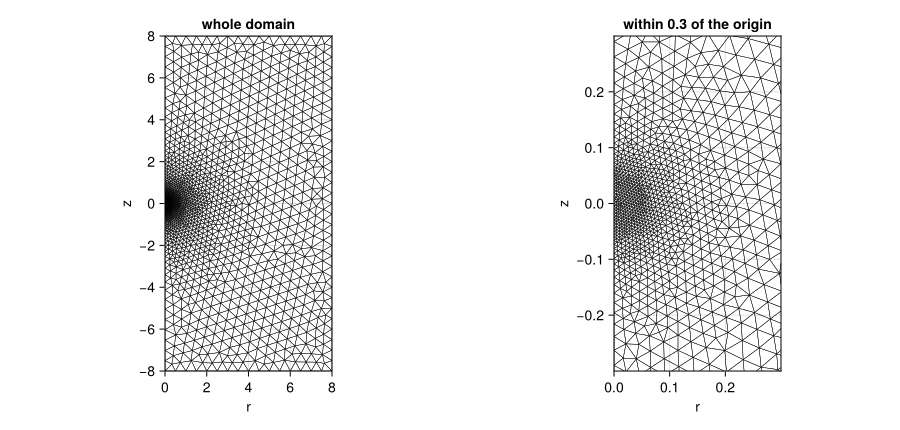
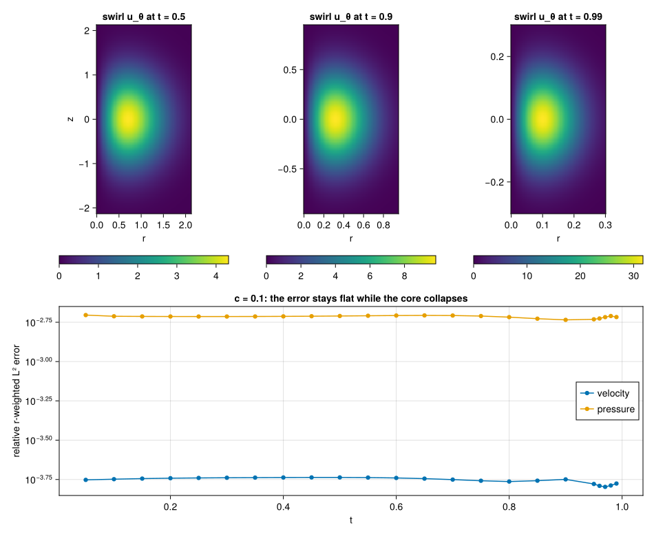

# Axisymmetric swirl: a collapsing core

This page shows what a finite element run of our axisymmetric-with-swirl Navier–Stokes
discretization does. The equations are the forced, incompressible, axisymmetric-with-swirl
Navier–Stokes equations in the half plane `(r, z)`, discretized with Taylor–Hood P2/P1 triangles
on a mesh graded toward the origin. The flow is a manufactured vortex core that collapses
self-similarly toward the origin, with the exponents of the forced-blowup paper: radial scale
`τ^(1/2)`, axial scale `τ^(1/2-h)` and speeds of order `τ^(-1/2-h)`, where `τ = 1 - t` and
`h = 0.01`. The page reports how accurately a static graded mesh tracks that core, and at what
cost.

It is not a reproduction, proof or disproof of that paper's result. The paper's blowing-up flow
is not axisymmetric (only its leading background field is), and its force has no closed form.
The driver here is our own manufactured field, and the force is defined as the residual of our
equations at that field.

The code is in `examples/axisym_swirl/`: `mesh.geo` (the mesh), `manufactured.jl` (the exact
field and its force), `axisym_swirl.jl` (the problem, the solve and the error norms),
`figures.jl` (renders the two images below) and `linear_residual.jl` (the linear solver check
below). The `NavierStokes` test group runs the example at two resolutions and asserts the
convergence rates.

## The equations

With velocity `(uᵣ, u_θ, u_z)`, pressure `p` and kinematic viscosity 1, on `r ∈ (0, R)` and
`z ∈ (-R, R)`:

```
∂ₜuᵣ + uᵣ∂ᵣuᵣ + u_z∂_z uᵣ - u_θ²/r + ∂ᵣp = (1/r)∂ᵣ(r∂ᵣuᵣ) + ∂_z²uᵣ - uᵣ/r² + fᵣ
∂ₜu_θ + uᵣ∂ᵣu_θ + u_z∂_z u_θ + uᵣu_θ/r   = (1/r)∂ᵣ(r∂ᵣu_θ) + ∂_z²u_θ - u_θ/r² + f_θ
∂ₜu_z + uᵣ∂ᵣu_z + u_z∂_z u_z + ∂_z p     = (1/r)∂ᵣ(r∂ᵣu_z) + ∂_z²u_z + f_z
(1/r)∂ᵣ(r uᵣ) + ∂_z u_z = 0
```

They are written in exactly this strong form, and each of the three momentum equations is
integrated by parts with the weight `r`: `ibp = Dict(eq => Weighted(r))`. That is the standard
axisymmetric Galerkin form. The measure is `r dr dz`, the viscous flux is `r ∇u`, and the
zero-order terms `u/r`, `uᵣu_θ` and `u_θ²` that remain are bounded on the axis, where
`uᵣ = u_θ = 0`. Without the weight the Laplacian would be tested in the wrong measure. The
continuity equation is first order and stays strong. It is written already weighted,
`0 ~ Dr(r * ur) + r * Dz(uz)`, and paired with the pressure.

`Weighted` is not exported by FiniteElementMethod; it lives in PDEBase:

```julia
using PDEBase.StrongForm: Weighted
```

## The driver

The exact field, with `ξ = r/√τ`, `ζ = z/τ^(1/2-h)`, the start-up ramp `s(t) = 1 - exp(-(t/0.1)²)`
and `G(ζ) = (ζ + 0.05) exp(-ζ²/2)`, is

```
uᵣ  = -s τ^(-1/2)   ξ exp(-ξ²/2) G′(ζ)
u_z =  s τ^(-1/2-h) (2 - ξ²) exp(-ξ²/2) G(ζ)
u_θ =  5 s τ^(-1/2-h) ξ exp(-ξ²/2) exp(-ζ²/2)
p   = -(25/2) s² τ^(-1-2h) exp(-ξ²) exp(-ζ²)
```

It is divergence free (it comes from a Stokes streamfunction), `uᵣ` and `u_θ` vanish on the axis,
and the pressure balances the swirl (`∂ᵣp = u_θ²/r`). The ramp makes every field and its time
derivative zero at `t = 0`, so the zero initial state is consistent. The flow is an inward spiral
with axial outflow above and below `z = 0`.

The force `f` is the residual of the equations above at this field. It is ours: it is singular
at `t = 1` and grows like `τ^(-3/2-h)`. Because the field is an exact solution of the forced
system, the error the run reports is the discretization error and nothing else.

The force expressions are thousands of characters long. The front end compiles source terms
without common subexpression elimination and evaluates them at every quadrature point and test
function, so `manufactured.jl` compiles them once with `build_function(...; cse = true)` and
registers the compiled functions with `@register_symbolic`. They depend on `(t, r, z)` only, so the
analysis accepts them as sources:

```julia
const FORCE_FUNCTIONS = Tuple(build_function(f, t, r, z; expression = Val(false), cse = true) for f in FORCE[1:3])
force_r(t, r, z) = FORCE_FUNCTIONS[1](t, r, z)
@register_symbolic force_r(t, r, z)   # and force_t, force_z
```

On a small case (`c = 0.4`, `τ_end = 0.5`, 1 691 unknowns) the registered force makes the solve take
0.5 s instead of 35 s, with the same errors to ten digits. The saving grows with the problem.

## The mesh

`mesh.geo` is the rectangle `r ∈ [0, 8]`, `z ∈ [-8, 8]` with the axis `r = 0` as one boundary, and
a size field about the origin: the target element size is `h(ρ) = min(hmax, max(hmin, c ρ))` for
`ρ` the distance to the origin, with `hmin = c √τ_end / 2` and `hmax = 5c`. Halving `c` therefore
halves the element size everywhere. The grading is geometric, so every ball of radius `ρ` holds
about the same number of elements, which is what a self-similar core needs: at time `τ` the
field has scale `√τ` and sits at `ρ ~ √τ`. The axial and radial scales differ by `τ^(-h)`, at most
1.1 for `τ ≥ 1e-4`, so isotropic elements are the right choice.



The mesh is built from the `.geo` file through the Gmsh API; parameters reach it with
`gmsh.onelab.setNumber` before `gmsh.open`, and `FerriteGmsh.togrid()` converts it:

```julia
gmsh.onelab.setNumber("Parameters/c", [c])
gmsh.open("examples/axisym_swirl/mesh.geo")
gmsh.model.mesh.generate(2)
grid = FerriteGmsh.togrid()
```

The facet sets are `axis`, `outer`, `top` and `bottom`.

**Why static.** The element count grows like `(1/c²) log(hmax/hmin)`, so every further decade of
`τ_end` adds a fixed number of elements. Remeshing in stages would save only that logarithmic
factor and needs the solution transferred between meshes, which the package has no API for. The
early steps pay for fine elements that the solution does not need yet; the implicit steps there
are cheap.

**Why `R = 8`.** The initial core has scale 1 and the field decays like `exp(-ξ²/2)`, which is
1.3e-14 at `r = 8` and smaller still for every `τ < 1`, since the core only shrinks. A larger box
buys nothing, and a smaller one would make the far boundary data matter early.

## Discretization and solve

```julia
@variables ur(..) ut(..) uz(..) p(..)
Ω = MeshDomain(grid)
Γaxis, Γout, Γtop, Γbottom = boundarypiece.(Ω, (:axis, :outer, :top, :bottom))
eqs = [
    Dt(UR) + UR * Dr(UR) + UZ * Dz(UR) - UT^2 / r + Dr(P) ~ laplacian(UR) - UR / r^2 + force_r(t, r, z),
    Dt(UT) + UR * Dr(UT) + UZ * Dz(UT) + UR * UT / r ~ laplacian(UT) - UT / r^2 + force_t(t, r, z),
    Dt(UZ) + UR * Dr(UZ) + UZ * Dz(UZ) + Dz(P) ~ laplacian(UZ) + force_z(t, r, z),
    0 ~ Dr(r * UR) + r * Dz(UZ),
]
P2, P1 = Lagrange{RefTriangle, 2}(), Lagrange{RefTriangle, 1}()
disc = FEMDiscretization(
    Ω, t; spaces = Dict(ur => P2, ut => P2, uz => P2, p => P1), pairing = Dict(eqs[4] => p),
    ibp = Dict(eqs[i] => Weighted(r) for i in 1:3), natural = [Γaxis], initializealg = CheckInit(), abstol
)
```

(`UR`, `UT`, `UZ`, `P` abbreviate `ur(t, r, z)` and so on, and `laplacian(w)` is
`(1/r) Dr(r Dr(w)) + Dz(Dz(w))`; `axisym_problem` in the example has the whole definition.)

- **Elements.** Taylor–Hood P2/P1, which is stable for the saddle-point structure. The measured
  pressure rate below is the Taylor–Hood rate of 2.
- **Axis.** `uᵣ = u_θ = 0` are Dirichlet conditions. `u_z` has no condition there and so carries the
  natural condition, which is declared with `natural = [Γaxis]`; the weighted flux `r ∂ᵣu_z`
  vanishes on the axis anyway. The log of the run has no boundary warning.
- **Far boundaries.** `outer`, `top` and `bottom` carry the exact velocity, which is about 1e-14
  of the core values at `R = 8`, so they are effectively no-slip; the exact values are kept so
  that the convergence check is clean.
- **Pressure.** There is no equation for it, and the package tests `∇p` strongly, so there is no
  do-nothing condition: the level is pinned to the exact pressure on `outer`, as in the
  [Navier–Stokes: flow past a cylinder](@ref).
- **Time integration.** The system is an index-2 DAE. It is integrated with `DFBDF`, with
  `CheckInit()` because the zero start is consistent (the ramp is zero at `t = 0`), and with
  UMFPACK for the linear systems. `abstol` is passed to `FEMDiscretization` and applies to
  the differential rows only; the pressure and Dirichlet rows stay out of the error control.
- **Newton matrix.** `NLNewton(new_W_dt_cutoff = 0)` refreshes the Newton matrix at every step. On
  the DFG example the default cutoff gives identical results and is faster, but here, at
  `c = 0.05`, the default leaves the pressure error at `t = 0.5` 22% larger (5.82e-4 instead
  of 4.76e-4, the velocity error unchanged to six digits) for a solve that is 16% faster (85 s
  instead of 101 s), so the example uses the refresh.
- **Direct solver and size.** UMFPACK holds the factors in memory: the peak of a run is 3.9 GiB at 124
  thousand unknowns and 9.5 GiB at 490 thousand (see the cost table). Its accuracy was measured on
  the Newton matrix `W` itself. `examples/axisym_swirl/linear_residual.jl` steps a run to `t = 0.5`,
  saves `W` and the right-hand side of the next step, and factorizes that one matrix with each solver in a process
  of its own:

  | unknowns | solver | factor and solve | relative residual `‖W x - b‖/‖b‖` | peak memory of the process |
  |---|---|---|---|---|
  | 124 138 | UMFPACK | 1.1 s | 6.4e-15 | 1.4 GiB |
  | 124 138 | KLU | 1015 s | 8.0e-6 | 8.4 GiB |
  | 490 169 | UMFPACK | 4.9 s | 2.6e-14 | 4.0 GiB |
  | 490 169 | KLU | not finished after 25 min | | at least 20 GiB, still growing |

  UMFPACK's default settings solve this system to rounding level at both sizes, about nine
  orders of magnitude below the spatial errors in the table below (1e-5 to 1e-6 for the velocity), so
  the linear solves do not contaminate those errors. KLU is both slower and less accurate here, which is why
  every run on this page uses UMFPACK. The residual was measured at one state, `t = 0.5`, not along the whole run, and only
  for this system; it says nothing about other saddle-point matrices. Every step of the runs needed about one Newton
  iteration (203 iterations for 202 steps to `t = 0.5` at `c = 0.05` and 207 for 203 at `c = 0.025`, with no
  Newton failure), so a linear solve error would not be iterated away; here it is at rounding level.
  For problems where UMFPACK's
  residual is poor, LinearSolve.jl [pull request #1414](https://github.com/SciML/LinearSolve.jl/pull/1414)
  proposes opt-in `pivot_tolerance` and `strategy` keys for `UMFPACKFactorization`; it was open when this page was written,
  so it is a route for large problems once a release contains it, not something this example uses.

## What the run shows

The error is the relative r-weighted `L²` error `√(∫ r e² dr dz) / √(∫ r u² dr dz)` against the exact
field, from the solver's dense output and an order-6 quadrature; the velocity error combines
the three components. The run goes to `τ_end = 1e-2`, that is `t = 0.99`, with `abstol = reltol = 1e-8`.
The size parameters are `c = 0.1`, `0.05` and `0.025`, i.e. 32 thousand, 124 thousand and 490 thousand
unknowns.

| `t` | `c = 0.1` velocity / pressure | `c = 0.05` velocity / pressure | rate | `c = 0.025` velocity / pressure | rate |
|---|---|---|---|---|---|
| 0.5  | 1.83e-4 / 1.95e-3 | 2.21e-5 / 4.76e-4 | 3.05 / 2.03 | 2.72e-6 / 1.19e-4 | 3.03 / 2.00 |
| 0.9  | 1.78e-4 / 1.84e-3 | 2.14e-5 / 4.78e-4 | 3.05 / 1.95 | 2.68e-6 / 1.19e-4 | 3.00 / 2.01 |
| 0.99 | 1.68e-4 / 1.92e-3 | 2.23e-5 / 4.86e-4 | 2.91 / 1.98 | 2.71e-6 / 1.19e-4 | 3.04 / 2.02 |

All nine cells were measured by running `axisym_solve` at the three values of `c`. A rate is
`log₂` of the error at one `c` over the error at the next, which halves the element size.

The rates are the Taylor–Hood rates: 3 for the velocity and 2 for the pressure. Between `t = 0.5`
and `t = 0.99` the velocity grows about sevenfold and the core shrinks from radius about 0.7 to
about 0.1, while the relative error stays flat on all three meshes. That is the point of the
graded mesh: the element count per core length stays the same as the core collapses.



Absolute errors grow with the fields (the pressure scales like `τ^(-1-2h)`), so the page reports
relative errors throughout.

### Cost

All runs went to `t = 0.99`, in 427 to 428 accepted steps with no rejected step and no Newton failure,
with one Julia process on the forge host (Julia 1.12.1, UMFPACK, 32 cores, other jobs running). The
solve time excludes compilation, about 55 s per process, and the peak resident memory includes it
(a process that only compiles and runs a 1.7 thousand-unknown case already holds 2.1 GiB).

| `c` | cells | unknowns | Newton matrix refreshes | mesh | assembly set-up | solve | peak memory |
|---|---|---|---|---|---|---|---|
| 0.1   | 4 870  | 32 324  | 74 | 0.04 s | 1 s    | 23.5 s  | 2.7 GiB |
| 0.05  | 18 894 | 124 138 | 77 | 0.18 s | 5 s    | 101 s   | 4.0 GiB |
| 0.025 | 75 004 | 490 169 | 77 | 0.97 s | 24 s   | 421 s   | 9.5 GiB |

"Assembly set-up" is the time of `axisym_problem`, which builds the discretization. The solve time grows slightly
faster than the unknown count: 4.3 times for 3.8 times the unknowns, then 4.2 times for 3.9 times.

## Limits

- **The run stops short of `t = 1`.** The prescribed field and its force are singular at
  `t = 1`, so no finite mesh or time step reaches it. A static mesh resolves the core only down to
  `τ ≈ τ_end` by construction. The runs here stop at `t = 0.99`.
- **Axisymmetric only.** The flow has no dependence on the angle; nothing here represents the
  non-axisymmetric structure of the paper's blowing-up flow.
- **Static mesh.** There is no remeshing and no solution transfer between meshes.
- **Direct solver and memory.** The solve is a sparse direct factorization. Its memory grows
  faster than the unknown count, 9.5 GiB peak at 490 thousand unknowns, and no iterative
  saddle-point solver is provided.
- **CPU only.** There is no GPU path.
- **The driver is manufactured.** The accuracy statements are about the discretization of a
  prescribed field; they say nothing about the stability of free Navier–Stokes flow.

## Reproducing the numbers and the images

```sh
julia --project=docs examples/axisym_swirl/axisym_swirl.jl 0.1 0.01        # c, τ_end
julia --project=docs examples/axisym_swirl/figures.jl                      # renders the images below docs/src/assets
GROUP=NavierStokes julia --project=. -e 'using Pkg; Pkg.test()'
```

The two images are committed in `docs/src/assets` and the documentation build does not solve
anything. `docs/src/assets/axisym_swirl.fnv1a` holds a checksum of the files they are rendered
from, and the `NavierStokes` test group fails when those files change without a re-render.
