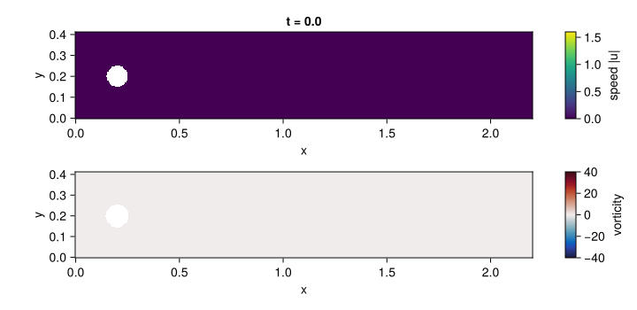
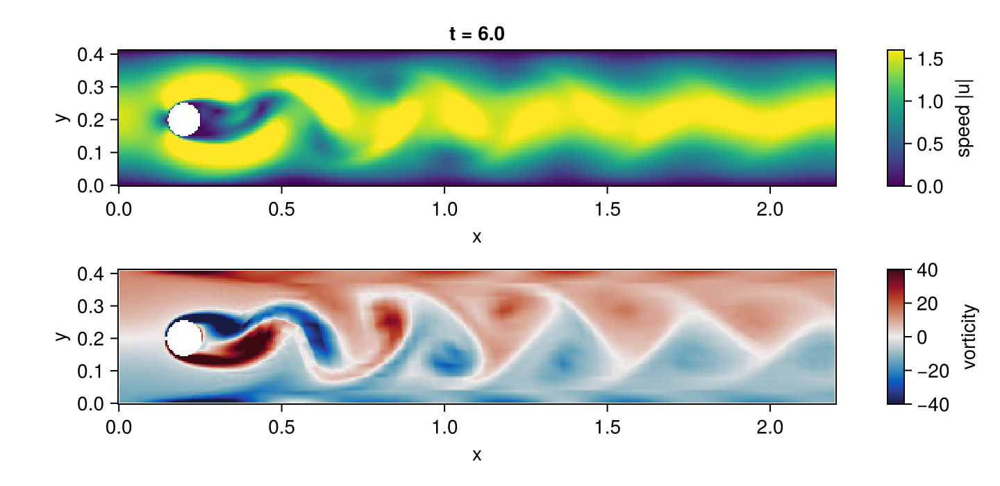

# Navier–Stokes: flow past a cylinder

The DFG benchmark of Schäfer and Turek (1996), case 2D-1: steady incompressible flow at
Reynolds number 20 past a cylinder of diameter 0.1 centred at (0.2, 0.2) in the channel
[0, 2.2] × [0, 0.41], with a parabolic inflow of peak 0.3, no slip on the walls and the
cylinder, and kinematic viscosity 10⁻³. It is a mixed saddle-point problem: the pressure has no
equation of its own and needs an inf-sup-stable pair, here Q2/Q1 Taylor–Hood.

The script is `examples/dfg_cylinder/dfg_cylinder.jl`; the mesh generator (`mesh.jl`), the
drag and lift functional (`forces.jl`) and a hand-written Ferrite solver used as an oracle
(`reference.jl`) sit next to it. The core is ordinary strong-form ModelingToolkit:

```julia
@parameters ν Umax
@variables x y u(..) v(..) p(..)
Dt, Dx, Dy = Differential(t), Differential(x), Differential(y)

Ω = MeshDomain(dfg_channel_grid(; h = 0.04, hc = 0.0025))     # Gmsh, all quadrilaterals, curved cylinder
Γin, Γout, Γwall, Γcyl = boundarypiece.(Ω, (:inlet, :outlet, :walls, :cylinder))
U, V, P = u(t, x, y), v(t, x, y), p(t, x, y)
eqs = [
    Dt(U) ~ Dx(ν * Dx(U)) + Dy(ν * Dy(U)) - U * Dx(U) - V * Dy(U) - Dx(P),
    Dt(V) ~ Dx(ν * Dx(V)) + Dy(ν * Dy(V)) - U * Dx(V) - V * Dy(V) - Dy(P),
    0 ~ Dx(U) + Dy(V),
]
inflow = (1 - exp(-t^2)) * 4Umax * y * (0.41 - y) / 0.41^2
bcs = [
    u(t, Γin) ~ inflow, v(t, Γin) ~ 0, u(t, Γwall) ~ 0, v(t, Γwall) ~ 0,
    u(t, Γcyl) ~ 0, v(t, Γcyl) ~ 0, p(t, Γout) ~ 0, u(0, x, y) ~ 0, v(0, x, y) ~ 0,
]
@named dfg = PDESystem(eqs, bcs, [(x, y) ∈ Ω, t ∈ Interval(0.0, 60.0)], [t, x, y], [U, V, P],
    [ν => 1e-3, Umax => 0.3])
Q2, Q1 = Lagrange{RefQuadrilateral, 2}(), Lagrange{RefQuadrilateral, 1}()
disc = FEMDiscretization(Ω, t; spaces = Dict(u => Q2, v => Q2, p => Q1),
    pairing = Dict(eqs[3] => p), natural = [Γout], initializealg = CheckInit())
prob = DAEProblem(dfg, disc)
abstol = [d ? 1e-7 : 1e8 for d in prob.differential_vars]   # pressure and Dirichlet rows out of error control
sol = solve(prob, DFBDF(nlsolve = NLNewton(new_W_dt_cutoff = 0), linsolve = UMFPACKFactorization());
    abstol, reltol = 1e-7)
```

## Vortex shedding at Reynolds number 100





The same formulation with the inflow of DFG case 2D-2 (peak 1.5, Reynolds number 100) is the second
code block of the [README](https://github.com/SciML/FiniteElementMethod.jl#navierstokes), and the
figure and the animation above are rendered by its third block, the plotting, with
[`examples/ns_showcase.jl`](https://github.com/SciML/FiniteElementMethod.jl/blob/master/examples/ns_showcase.jl).
They are committed copies in `docs/src/assets`, the same files the README links to; a test fails
when the blocks change without them being regenerated, and the documentation build re-runs both blocks to check
that they still run. The velocity is sampled on a regular grid with `sol(ts, xs, ys; dv)`, which returns `NaN`
inside the cylinder, and the vorticity is a central difference of the sampled velocity. The flow
starts at rest, the wake behind the cylinder turns unstable and a von Kármán vortex street has
formed by `t = 6`. It is a showcase, not a validated 2D-2 run: the mesh is the coarse `h = 0.04`
mesh of the steady case above and the tolerance is `10⁻⁶`. The test suite checks only that the wake
sheds with a Strouhal number between 0.25 and 0.35 (measured 0.28 to 0.31, against about 0.3 for
the benchmark), not the benchmark's amplitudes or lift oscillation.

## Formulation choices

- **Outflow condition.** PDEBase's strong-form analysis integrates only second-order terms by
  parts, so the pressure gradient is tested strongly and the natural outflow condition is
  `ν ∂ₙu = 0` instead of the do-nothing condition `ν ∂ₙu − p n = 0` of the benchmark. The
  pressure level is fixed by `p = 0` on the outlet. The hand-written Ferrite solver gives the
  same drag, lift and pressure difference to seven digits with either formulation on five
  meshes from 5 000 to 149 000 unknowns.
- **Index-2 DAE.** The continuity equation is paired with the pressure explicitly. The flow
  starts at rest and the inflow is ramped by `1 − exp(−t²)`, whose value and rate vanish at
  `t = 0`, so the zero initial state is consistent and `CheckInit()` only verifies it. The
  default initialiser would solve the algebraic rows for the algebraic variables, and the
  continuity rows do not contain the pressure, so its Newton matrix would be singular in the
  pressure columns. The zero
  velocity is discretely divergence free; the pressure, an algebraic variable, starts at zero
  and needs no initial condition, since every residual row vanishes at `t = 0`. The
  pressure and the Dirichlet rows are left out of the error control: the local error of an
  index-2 variable does not shrink with the step.
- **Steady state.** 2D-1 is steady; the DAE is integrated to `t = 60`, where the flow has
  settled to the solver tolerance, and the coefficients include the `∂ₜu` term of the
  functional.
- **Linear solver.** UMFPACK is named because LinearSolve 5.18's default sparse LU throws
  "snlu! requires the same sparsity pattern as the analyzed matrix" on these Newton matrices
  (and on Ferrite's own `ns_vs_diffeq.jl` tutorial). Naming it also removes the default's
  silent fall-back to sparse QR on a singular Newton matrix, which costs tens of gigabytes
  here; the example's `check_solved` raises if the solve stops before its final time.

## Drag and lift

The coefficients are the weighted residuals of the momentum equations (John 2004; Braack and
Richter 2006): with `w` the finite-element function equal to `e_k` at the cylinder nodes and
zero elsewhere, `F_k = −∫ (∂ₜu·w + ν∇u:∇w + (u·∇)u·w − p ∇·w) dx` and `c = 2F/(Ū² D)` with
`Ū = 0.2`, `D = 0.1`. This volume form converges at twice the rate of the line integral of
the discrete stresses.

**Tolerance.** The acceptance intervals of the benchmark paper, `c_D ∈ [5.57, 5.59]`,
`c_L ∈ [0.0104, 0.0110]` and `Δp ∈ [0.1172, 0.1176]` (reference values 5.57953523384,
0.010618948146 and 0.11752016697). The `NavierStokes` test group solves on a 16 430-unknown
mesh and asserts the three intervals, and agreement with the hand-written Ferrite Newton
solver on the same mesh to a relative 10⁻⁵. Benchmark (d) in `benchmarks/navier_stokes`
repeats the solve on finer meshes and records the errors against the reference values.

This is the evidence that moves mixed saddle-point problems into Tier 1 of the supported
equation classes.
